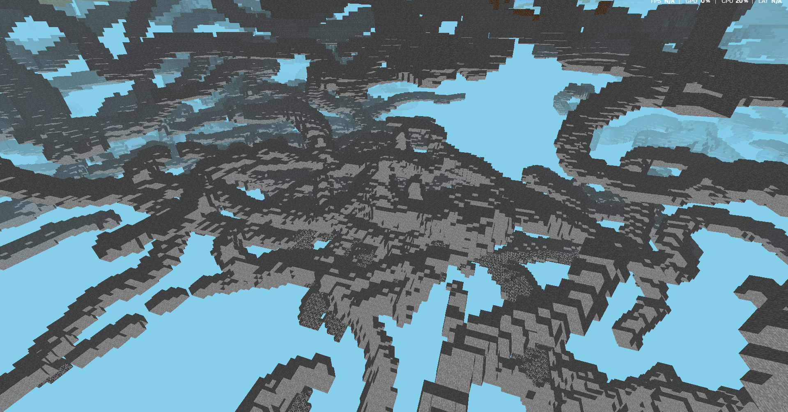

A Minecraft-inspired terrain generator

May be a bit laggy on lower end devices since a render distance of 16 is hardcoded
Caves can be seen on the surface of terrain, and can also be found by flying through the ground

To run the application, go to the releases page and download the .exe, it should run fine! :)

.png)
.png)

